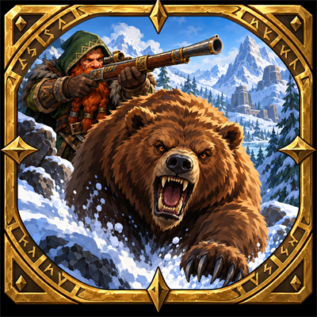

# Forever Hunter Pets

**Find every beast, learn every rank.** An addon for **WoW Forever** that catalogues which beast teaches which rank of a pet ability and where it lives – and turns finding them into a game. Everything it knows was found in the game by players of the addon: what you see and tame is noted and shared, and what nobody has found yet becomes your next hunt. Play in **complete mode** to see everything that is known, or in **explorer mode** to see only what you discovered yourself and how much is still out there.

## What it does

- **Abilities** – every rank, the beasts that teach it, their spawn points on the zone map, and which ranks you have learned.
- **Area** – a progress book per zone: which beasts live here, what they teach, and how many you know.
- **Training** – what your active pet can learn right now, like the classic training window.
- **Beast tooltips** – what a beast teaches and whether you know it already, as you hover over it.
- **Collects as you play** – targeting, hovering, nameplates, *Track Beasts*, taming and *Beast Training* all feed the catalogue, and players of the addon share with each other in the game.

The addon is available in English and German and follows the language of your client.

**Full documentation: [User Guide](https://github.com/Jazzman1976/Forever-Hunter-Pets/blob/main/docs/guide/guide.md)** – modes, every view, how the addon learns, sharing, settings, commands.

## Installation

Clone or unpack into `<World of Warcraft>\_classic_beta_\Interface\AddOns\Forever-Hunter-Pets` (the folder name must match the `.toc` file), start the game and type `/fhp`. Details in the [User Guide](https://github.com/Jazzman1976/Forever-Hunter-Pets/blob/main/docs/guide/guide.md#installation).

## Data and license

The addon ships only data collected in the game and reads names, icons, maps and models from your client – nothing from websites or other addons ([NOTICE.md](https://github.com/Jazzman1976/Forever-Hunter-Pets/blob/main/NOTICE.md)). Code and collected data are released under the [MIT license](https://github.com/Jazzman1976/Forever-Hunter-Pets/blob/main/LICENSE), and so is the logo as far as rights in it exist. Game content belongs to Blizzard Entertainment. World of Warcraft and Blizzard Entertainment are trademarks or registered trademarks of Blizzard Entertainment, Inc. This project is not affiliated with or endorsed by Blizzard Entertainment.

## Contributing

Play with the addon and leave sharing on – that is the easiest contribution. More in [CONTRIBUTING.md](https://github.com/Jazzman1976/Forever-Hunter-Pets/blob/main/CONTRIBUTING.md). The developer documentation is in German: [docs/konzept/konzept.md](https://github.com/Jazzman1976/Forever-Hunter-Pets/blob/main/docs/konzept/konzept.md) (goals, concept, decisions) and the technical pages linked there.
