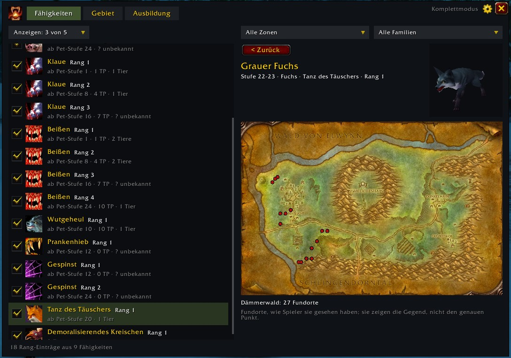
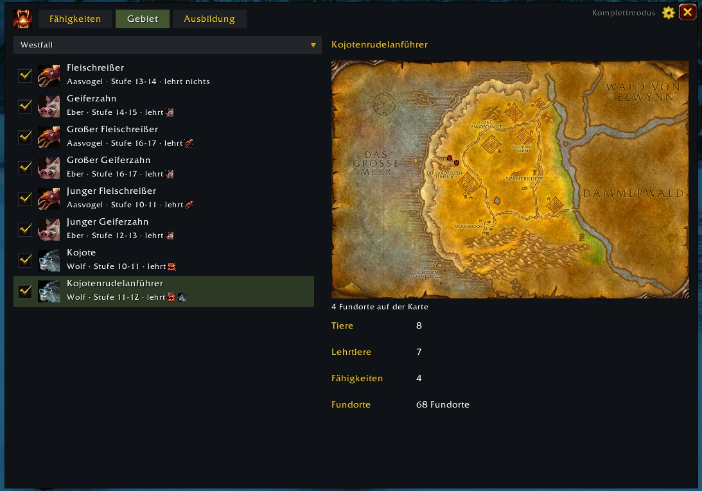
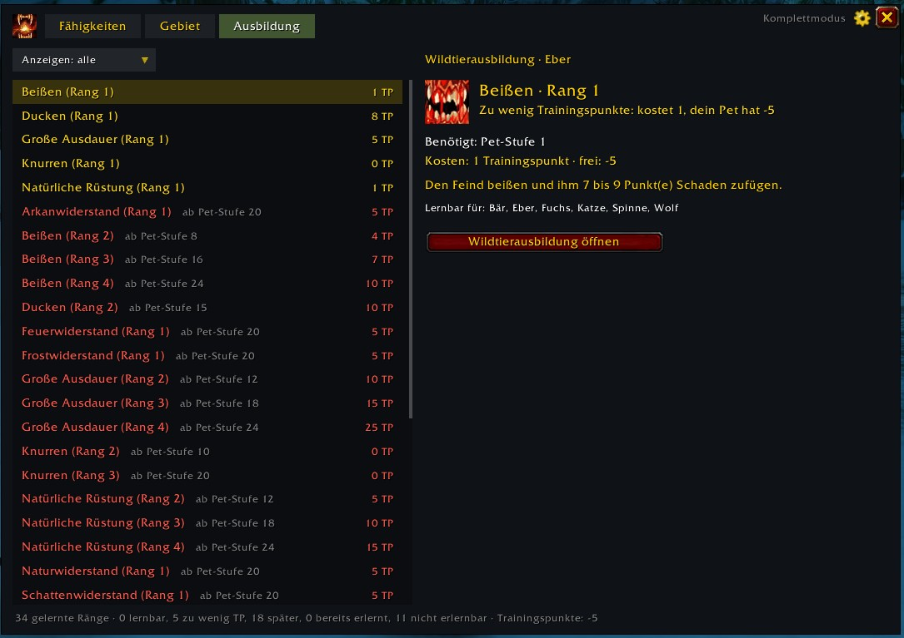
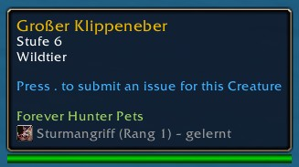
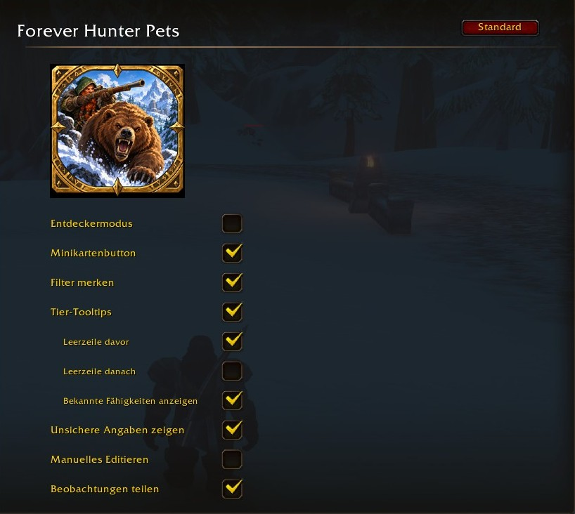

# Forever Hunter Pets – User Guide

Everything the addon does, how it works and why it behaves the way it does. Short version in the [README](../../README.md).

**Contents:** [The idea](#the-idea) · [Getting started](#getting-started) · [Complete mode and explorer mode](#complete-mode-and-explorer-mode) · [The window](#the-window) · [Abilities](#abilities) · [Area](#area) · [Training](#training) · [Beast tooltip](#beast-tooltip) · [How the addon learns](#how-the-addon-learns) · [Your learning progress](#your-learning-progress) · [Sharing with other players](#sharing-with-other-players) · [Trustworthy data](#trustworthy-data) · [Settings](#settings) · [Commands](#commands) · [Questions and answers](#questions-and-answers)

## The idea

Hunters learn pet abilities from beasts: tame a beast that knows a rank, let it use the ability in combat until the game says you learned it, and from then on you can teach that rank to every pet. The hard part is knowing **which beast teaches which rank, and where it lives**.

Forever Hunter Pets answers that – and turns the search into a game:

- **Find everything.** The addon catalogues every ability, every rank, every beast that teaches it and every place it was seen.
- **Collected in the game.** Nothing comes from websites or other addons. What the addon knows was found by players of the addon – by you, and by others who share what they see.
- **Gaps are tasks.** What nobody has found yet is shown as such (*? unknown*, *spawn point unknown*). Finding it is part of the fun.
- **Your choice how much you want to see.** In *complete mode* you get everything that is known. In *explorer mode* you only see what you found yourself – and how much there is left to discover.

The addon follows the language of your client (English and German).

## Getting started

### Installation

The folder in `AddOns` must be named `Forever-Hunter-Pets`, like the `.toc` file inside it.

- **With git** (easy to update with `git pull`):
  ```
  cd "<World of Warcraft>\_classic_beta_\Interface\AddOns"
  git clone https://github.com/Jazzman1976/Forever-Hunter-Pets Forever-Hunter-Pets
  ```
- **Without git:** download the ZIP, unpack it into `AddOns` and rename the folder (for example `Forever-Hunter-Pets-main`) to `Forever-Hunter-Pets`. This file must exist afterwards:
  `<World of Warcraft>\_classic_beta_\Interface\AddOns\Forever-Hunter-Pets\Forever-Hunter-Pets.toc`

`_classic_beta_` is the client folder during the beta; use the folder of the client you play WoW Forever with. Start the game (a new addon needs a full restart, `/reload` is not enough) and make sure **Forever Hunter Pets** is ticked under **AddOns** on the character selection screen.

**Updating:** `git pull` or replace the folder. Your progress and collected data live in the client's `WTF` folder and survive the update. After an update that adds new files, restart the game once.

**Coming from version 0.5.0 or older:** the folder used to be called `ForeverHunterPets`. Delete the old folder, and in `WTF\Account\<account>\SavedVariables` (and in each character's `SavedVariables` folder) rename `ForeverHunterPets.lua` to `Forever-Hunter-Pets.lua` to keep your progress.

### First start

Type `/fhp` or click the button at the minimap. The first time a character opens the addon, it asks **how you want to play**:

- **Complete mode** – shows everything that is known. You don't have to search for anything.
- **Explorer mode** – shows only what you have found yourself, and how much there is still to discover.

Until you choose, the addon shows nothing that could spoil the search; it already collects in the background. Every character chooses on its own; you can change it any time in the settings. The current mode is shown in small letters in the top right corner of the window, next to the gear.

## Complete mode and explorer mode

| | Complete mode | Explorer mode |
| --- | --- | --- |
| Meant for | players who want the answer | players who want to search |
| Teaching beasts, names, spawn points | everything that is known: the shipped data, what other players shared, what you found | only what you found yourself |
| Beasts you have not found | shown with their name, like all others | shown anonymously as *? undiscovered beast*, or as a count (*2 undiscovered*) |
| Status of a beast (*tracked* …) | not shown – it doesn't matter there | shown in the beast tooltip and in the Area tab |
| Progress in the Area tab | how much of the zone is known at all (the state of data collection) | how much of the zone **you** know |
| Collecting and sharing | on | on – explorers help everybody |

Your finds count for your whole account: a beast one of your characters found counts as found for your other characters as well. The mode is chosen per character.

## The window

Three tabs: **Abilities**, **Area** and **Training**. Top right: the current mode, the gear (opens the settings) and the close button.

## Abilities

Every pet ability, rank by rank, and the beasts that teach it.



**The list (left).** One row per rank: name, rank, from which pet level, training point cost, and how many beasts teach it (*3 beasts*). In explorer mode, beasts you have not identified yet are counted instead (*2 undiscovered*). *? unknown* means nobody has found a beast for this rank yet. The checkbox shows whether **you, the hunter,** have learned the rank (see [learning progress](#your-learning-progress)). *your pet knows it* marks ranks your current pet has, but you haven't learned yet – don't release that pet too early.

**Filters (top).**
- **Show** (left) – a multi-select. By status, from the hunter's point of view: **available** (not learned yet, and a beast up to your level or the pet trainer teaches it), **unavailable** (every known teaching beast is above your level, or none is known), **already known**. By source: **innate** (what a beast brings along and can never be taught, like its attack speed) and **Pet trainer** (learned from the trainer, no taming needed). A tick means "is shown".
- **Zone** and **family** (right). *Current zone* follows where you stand, *Current family* your active pet. With a zone selected, *available* means available in this zone.
- The addon remembers your filters per character (setting *Remember filters*).

**Details (right).** Icon, name, rank, description, which families can learn it, and the teaching beasts – the easiest first, split into *Tameable at your level* and *Above your level*. The recommended beast has a star. Hover over a beast for its level, classification, family, zones and an **effort** rating (easy, medium, hard – based on level, elite or rare, dungeon or raid, number of known spawn points, enemy faction territory). Uncertain beasts are listed under their own heading and marked **?** (see [trustworthy data](#trustworthy-data)). In explorer mode, teaching beasts you have not identified yourself appear as *? undiscovered beast*.

**Beast page.** Click a beast: its 3D model (drag to rotate) and the zone map with its spawn points. The map is revealed as far as your character has explored the zone, like the world map. Spawn points show the area, not the exact spot (see [spawn points](#spawn-points)).

## Area

A progress book for one zone at a time. Pick the zone at the top; it starts with the zone you are in.



**The beasts (left).** Every beast of the zone, with the checkbox from *Abilities*, its family icon, its name and below: family, level and what it teaches – *teaches* followed by the ability icons (hover over the row for names and ranks), *teaches nothing*, or *? unclear* when nobody knows yet.

- **Explorer mode:** each beast carries its status, and the checkbox follows it:

  | Status | Meaning | Checkbox |
  | --- | --- | --- |
  | *? undiscovered beast* | you haven't come across it in this zone yet – name hidden | none |
  | **tracked** | you have seen it in this zone, but were never close to it | none |
  | **beast found** | you were close to it in this zone, so its spawn point is on your map | empty |
  | **abilities known** | found, and you have tamed it – you know what it teaches | ticked |

  Sorted by status: known first, undiscovered last. Undiscovered beasts can't be selected.
- **Complete mode:** every beast with its name, no status. The checkbox is ticked when it is known what the beast teaches. Beasts with known abilities come first.

**The map (right).** Shows the spawn points of the selected beast – one beast is always selected, otherwise the map would be covered in pins. In explorer mode only your own spawn points. Click another beast to switch.

**The counters (below the map).**
- **Beasts** – *X of Y known*. Only *abilities known* moves the bar; tracking and finding a beast don't. Hover over it to read what the statuses mean.
- **Teaching beasts** – *X of Y identified*: beasts of this zone that teach something.
- **Abilities** – *X of Y ranks discovered*: ranks taught by beasts of this zone. Ranks from the pet trainer don't count – you don't have to search for them.
- **Spawn points** – explorer mode: your own spots (cells); complete mode: all known spawn points of the zone.

When everything is known (X = Y), only the number is shown, without a bar. In explorer mode, X is what you know; in complete mode, X is what is known at all – so the bars show how far data collection has come, and in complete mode *Teaching beasts* and *Abilities* are usually just numbers.

## Training

Your learning progress as a list for your **active pet**, coloured like the game's own window – and always with a word, never by colour alone: **learnable** (green), **not enough TP** (yellow), **pet level too low** (red), **already learned** and **for other families** (grey). Hover for the reason. Training points: only the difference counts – if your pet has *Bite 3*, *Bite 4* costs only the difference. **Show** hides any of these states.



The button **Open Beast Training** opens the game's window. Teaching happens there: the game does not let addons teach.

## Beast tooltip

When you hover over a beast, the addon adds its lines below **Forever Hunter Pets**:



1. **Status** (explorer mode only): *tracked*, *beast found* or *abilities known*.
2. **Attack speed** if it differs from normal (for example *Faster Attack III (1.5 s)*) – your pet takes it over.
3. **Every rank it teaches**, with the ability icon: *– learned* (grey) if you already know the rank, *– new* (green) if not.
4. *teaches nothing* (grey) when it is known that the beast teaches nothing.

In explorer mode only what your own taming showed is listed. Uncertain ranks carry a **?** (only if you switched them on). Settings: switch the tooltip off, add an empty line before or after (to separate it from other addons), and hide ranks you already know (*Show known abilities* – this also hides *teaches nothing*).

## How the addon learns

The addon quietly notes what you see – outside combat and instances, without slowing the game down.

### Seeing a beast

The addon looks at beasts you **target**, **hover over** with the mouse, or see with a **nameplate** (enemy nameplates must be switched on – then it notices beasts just by riding past).

| Distance | What is noted |
| --- | --- |
| any distance | a **track** in your current zone, plus the beast's name and family |
| about 28 m | name, level, classification, family and attack speed – this is shared |
| about 10 m | the **spawn point** (see below) |

**Tips for tracking:** *Track Beasts* – the names under the paw marks on your minimap give a track when you hover over them. *Eagle Eye* and *Eyes of the Beast* – hover over beasts far away to get tracks. While you look through them, no spawn points are recorded: you are standing somewhere else.

### Spawn points

The game only tells the addon where **you** are, not where the beast is. So a spawn point is only recorded when the beast is within about **10 m**, and rounded to a grid of 2 % of the map (about 60–100 m). The map therefore shows "around here", and a wandering beast leaves a trail of cells – which helps the search. Precise points matter more than many points; that is why the distance is short.

**Fighting a beast** gives you its spawn point too: on the way in, or next to it after the fight. During combat itself the addon rests – the game hides most information then.

### Taming

When you tame a beast, the addon notes what it actually brought along: its abilities and ranks, its level and its attack speed, and the spot where you started taming (always – *Tame Beast* only reaches about 30 m). The chat says *Observed: … brought …*. A tamed beast is *abilities known* in its zone.

### Beast Training and the pet trainer

Whenever you open *Beast Training* or visit the pet trainer, the addon reads the abilities and ranks shown there: spell, rank, pet level, cost. A new ability counts at once – you don't have to wait for an update. Calling a pet also reads its spellbook and its family icon.

## Your learning progress

The addon keeps track of which ranks **you, the hunter,** have learned – per character and rank by rank (rank 3 doesn't mean you have rank 2):

- from the *Beast Training* window, each time you open it,
- from the message *You have learned a new spell*.

What your pet knows does not count – you only have the rank once the game says so. Until then the addon shows *your pet knows it* / *not learned yet*. To tick or untick ranks by hand, switch on **Manual editing** in the settings.

## Sharing with other players

Addons can't reach the internet, so players share in the game: over your guild, your group and a hidden channel (`FHPetsNet`). Shared are: beasts you saw (name, level, family, classification, attack speed), what tamed beasts brought along, and spawn points – with the time and a short code instead of your name. No character names are stored. Messages are throttled, so the channel stays quiet.

What other players share shows up in your addon right away. It becomes part of the shipped data under the MIT license only once enough different players have confirmed it (see [Trustworthy data](#trustworthy-data)); by playing with sharing on, you agree to this. The short code is derived from the character name: it keeps names out of the data, but it is a pseudonym, not full anonymity.

Switch **Share observations** off and nothing is sent or received.

## Trustworthy data

- **What you saw yourself** counts as confirmed – both that a beast teaches a rank and that it doesn't.
- **What other players report** counts once **10 different players** saw the same. Until then it is *uncertain*: hidden by default; switch on *Show uncertain beasts* and it appears marked **?**.
- **A beast tamed without a rank although its level was high enough** is never shown as teaching it.
- **WoW Forever is in beta** and changes weekly. Where nothing is known, the addon says so instead of guessing.

## Settings

Game options → **AddOns → Forever Hunter Pets**, or the gear in the window.



| Setting | Default | What it does |
| --- | --- | --- |
| Explorer mode | off (asked at first start) | explorer mode for this character; off = complete mode |
| Minimap button | on | button at the minimap; Ctrl + drag to move it |
| Remember filters | on | keeps the filters of *Abilities* and *Training* per character |
| Beast tooltips | on | the addon's lines in beast tooltips |
| – Empty line before / after | on / off | separates the lines from other addons |
| – Show known abilities | on | also lists ranks you have learned, and *teaches nothing* |
| Show uncertain beasts | off | beasts fewer than 10 other players have reported, marked **?** |
| Manual editing | off | tick or untick learned ranks by hand |
| Share observations | on | share with and receive from other players |

## Commands

| Command | Effect |
| --- | --- |
| `/fhp` | open or close the window |
| `/fhp area` | progress of the zone you are in, in the chat |
| `/fhp survey` | what was collected from Beast Training, the pet trainer and pets |
| `/fhp share` | sharing status: what was sent and received this session (tamings, sightings, spawn points, greetings), what was stored or dropped and why, and the last message from another player |
| `/fhp zones` | zones the addon has no map for |
| `/fhp api`, `/fhp map`, `/fhp tame` | developer tools: probes that write a log to the saved variables |

## Questions and answers

**A beast is called *Unknown beast (#833)*.** The addon only knows its number. Target it or hover over it once – from any distance – and its name appears.

**I stood right next to beasts, but no new spawn point appeared.** Spawn points are kept once per beast and cell (about 60–100 m). Another beast of the same kind in the same area adds nothing new. The beast must also be targeted, hovered over or have a visible nameplate.

**My tamed beast "brought no ability".** Some beasts teach nothing. If you are sure it does: open *Beast Training* with that pet once, then the addon knows the ability.

**A beast shows no status in the tooltip.** Status is shown in explorer mode only, and only for beasts that live in this zone or that you tracked here.

**Where is my data?** In `WTF\Account\<account>\SavedVariables\Forever-Hunter-Pets.lua` (shared by your characters) and in each character's `SavedVariables` folder (mode, learning progress, filters).
